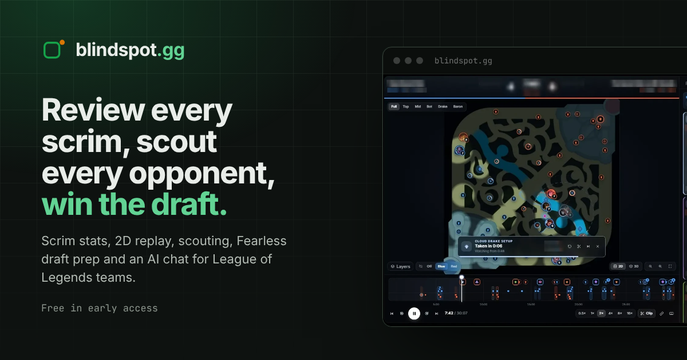

# Hi, I'm Andrej 👋

### Full-stack developer · React, TypeScript & .NET · mobile games with Godot

I build complete products, from the interface to the API, the database, the deployment and the AI on top.
Right now I'm shipping a live SaaS, a children's mobile game, and starting more projects every month.

---

## 🚀 What I'm working on

| Project | What it is | Stack | Status |
|---|---|---|---|
| [**Blindspot.gg**](https://blindspot-gg.com) | SaaS coaching platform for League of Legends teams: scrim stats, 2D replay, scouting, draft rooms, AI chat | React 19 · TypeScript · ASP.NET Core · PostgreSQL · Claude API | 🟢 Live |
| **Magic Flying Garden** | Collectible game for children: open surprise bags, collect 150 animals, care for them on a painted world map. No ads, no in-app purchases, no tracking | Godot 4 · GDScript · Android & iOS · 3 languages (DE / EN / HR) | 🟡 In development |

## ⭐ Featured: Blindspot.gg

A live commercial product that I designed, built and run end to end.

- 📊 **Scrim tracking & stats**: every player rated 0–100 against role benchmarks
- 🎬 **2D replay & game review**: fights on a timeline, objective setups, clips
- 🔎 **Opponent scouting** from pro match data, plus **live draft rooms** with an OBS overlay
- 🤖 **AI chat on Claude**: read-only lookups on the team's own data, streamed answers, saved conversations
- 🏗️ **220+ API endpoints**, tenant-isolated per organisation, Stripe billing, Riot / GRID / Oracle's Elixir integrations
- 📱 One React codebase shipped as web app, PWA and iOS / Android apps (Capacitor); Docker on Render behind Cloudflare, CI on GitHub Actions

**→ [Read the case study](https://github.com/AndrejDev10/blindspot-case-study)** · **[Visit the live site](https://blindspot-gg.com)**

## 🎮 Featured: Magic Flying Garden

A calm, ad-free collecting game for kids, built with **Godot 4** for Android and iOS.

- 🎁 Surprise bags with animated reveals and rarity effects (holo shader, light rays)
- 🗺️ A big painted world map with 12 habitats where all **150 hand-built animals** live together
- 🍎 Feeding, playing, friendship levels, baby animals, daily quests, weekly story adventures
- 🧩 Mini-games, seasons and weather, text-to-speech, a parent area with play-time limits
- 🔒 Privacy first: no microphone, no tracking, no ads, works offline

## 💼 What I can build for you

| | |
|---|---|
| 🧩 **Full-stack web apps** | React + TypeScript front end, ASP.NET Core API, PostgreSQL, auth, payments, Docker deploys and CI |
| 🎨 **Frontend & UI** | Polished React interfaces: dashboards, data-heavy tables and charts, design systems, PWAs and mobile builds |
| ⚙️ **.NET backends & APIs** | Third-party integrations, background importers, scheduled jobs, multi-tenant data with EF Core |
| ✨ **AI features** | LLM features that answer from *your* data: chat assistants with tool lookups, streaming, usage limits |
| 📱 **Mobile apps & games** | Capacitor apps from a web codebase, or native-feeling games with Godot |

## 🛠️ Tech I work with

**Frontend** &nbsp;     

**Backend** &nbsp;    

**Mobile & games** &nbsp;    

**DevOps** &nbsp;    

## 📬 Let's talk

Have an idea, a product that needs building, or an AI feature your users would love?
**[Send me an email](mailto:andrej.kukuruzovic@gmail.com)** or write me on **[X](https://x.com/HumnamDev)**.
