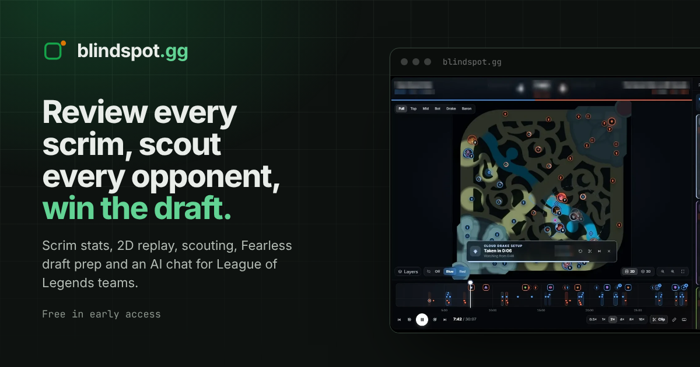

# Hi, I'm Andrej 👋

**Full-stack developer — React, TypeScript & .NET.** I design, build and ship complete web products: the interface, the API, the database, the deployment, and the AI features on top.

---

## What I can build for you

| | |
|---|---|
| 🧩 **Full-stack web apps** | From idea to production: React + TypeScript front end, ASP.NET Core API, PostgreSQL, auth, payments, Docker deploys and CI. |
| 🎨 **Frontend & UI** | Fast, polished React interfaces: dashboards, data-heavy tables and charts, design systems, landing pages, PWAs and mobile builds. |
| ⚙️ **.NET backends & APIs** | ASP.NET Core APIs, third-party integrations, background importers and scheduled jobs, multi-tenant data with EF Core. |
| ✨ **AI features** | LLM features that answer from *your* data: chat assistants with tool lookups, streaming answers, usage limits and feedback loops. |

## Featured work

### [Blindspot.gg](https://blindspot-gg.com) — a SaaS coaching platform for League of Legends teams

A live product I designed, built and run end to end: scrim tracking and stats, a 2D replay and game review, opponent scouting from pro data, live draft rooms, SoloQ tracking, and an AI chat that answers from the team's own data.

- **React 19 + TypeScript** single-page app, also shipped as a PWA and as iOS / Android apps (Capacitor)
- **ASP.NET Core** API with 220+ endpoints on **PostgreSQL**, tenant-isolated per organisation
- **AI chat on Claude** with read-only data lookups, streamed answers and saved conversations
- Integrations with the Riot Games API, Oracle's Elixir, GRID and Stripe; deployed with Docker on Render behind Cloudflare, with CI on GitHub Actions

**→ [Read the case study](https://github.com/AndrejDev10/blindspot-case-study)** · **[Visit the live site](https://blindspot-gg.com)**

## Tech I work with

